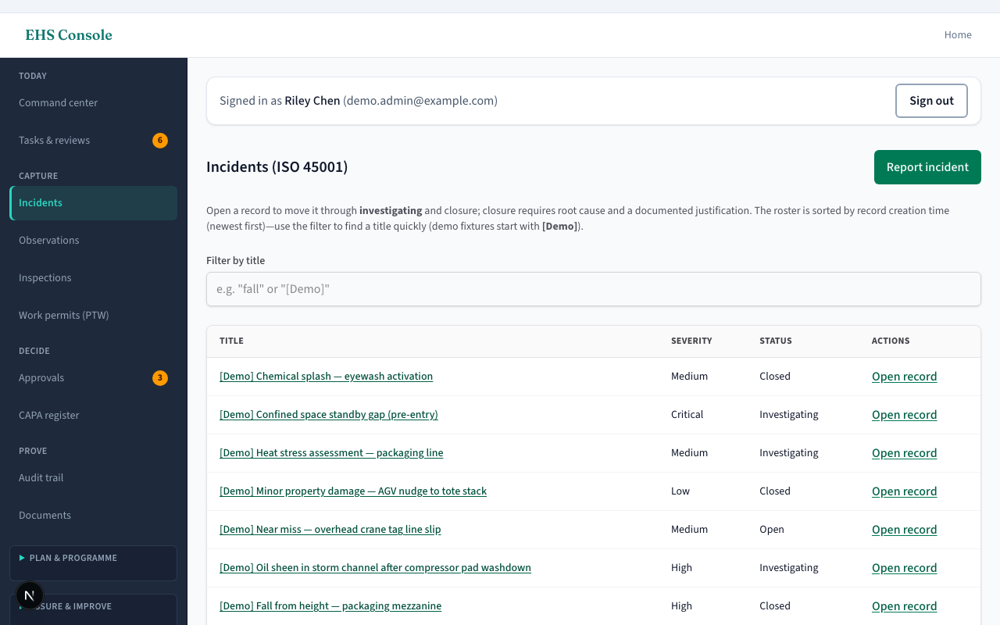
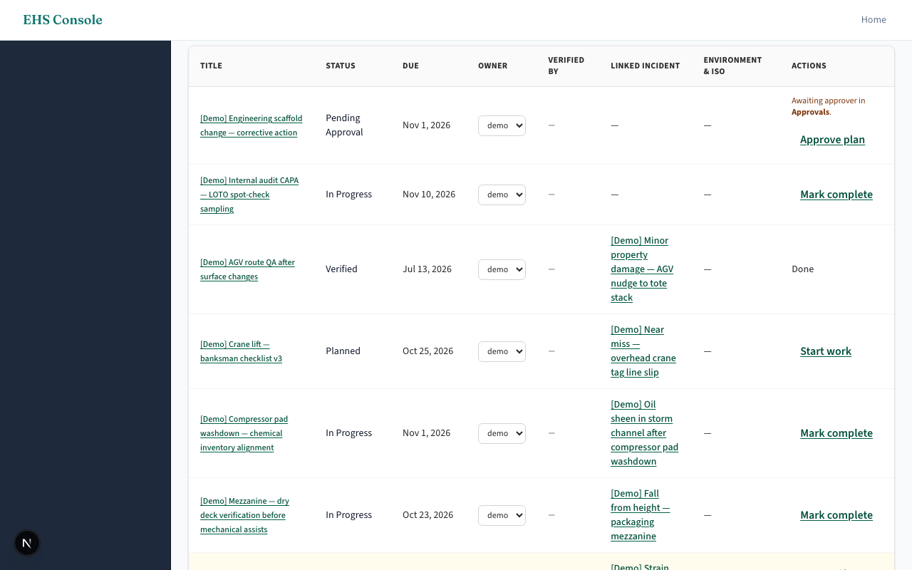
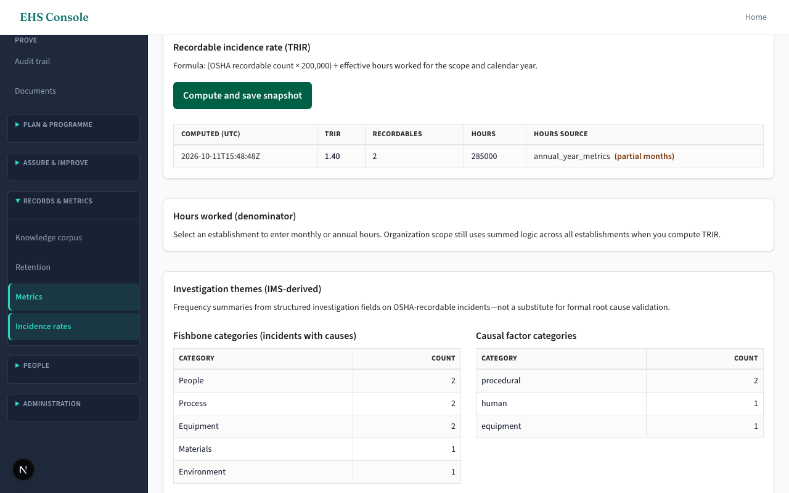

# Self-hosted EHS console

[](https://github.com/SafetyMP/Autonomous-EHS-Management/actions/workflows/ci.yml)
[](LICENSE)

Record an incident, link a CAPA, and walk that CAPA to verified, on PostgreSQL you run. Optional AI may suggest wording. A person closes the record. This software does not claim OSHA certification and is not an official filing tool.

The public path is that spine. Other modules ship in the tree; maturity is listed in [docs/module-maturity.md](docs/module-maturity.md).

**Record an incident**



**Link a CAPA**



**Read TRIR**



## TRIR

Incidence rates use `(recordable count × 200,000) / hours worked`.

- A complete grid of 12 months, each with hours, is the denominator.
- A partial month grid does not replace the annual total. The snapshot warns and uses `establishment_year_metrics.total_hours_worked` when that value exists.
- With neither a full grid nor an annual total, the rate is not computed.

## Run the demo

Prerequisites: Node.js 22 (`.nvmrc`), npm, Docker.

```bash
git clone https://github.com/SafetyMP/Autonomous-EHS-Management.git
cd Autonomous-EHS-Management
npm ci
cp .env.demo.example .env.local
npm run demo:up
npm run dev
```

Postgres from `docker-compose.demo.yml` is on host port **5433**. `DATABASE_URL` in `.env.demo.example` must use that port, with `DATABASE_USE_PG=1`. Set `BETTER_AUTH_SECRET` to at least 32 characters. Do not enable `DEMO_MODE` on a production deployment.

Open [http://localhost:3000/sign-in](http://localhost:3000/sign-in) and use **Try demo admin**, or the demo email and password from `.env.local`. Health check: [http://localhost:3000/api/health](http://localhost:3000/api/health).

Walk an incident into a verified CAPA from the console. The same path is covered by `tests/e2e/smoke/core-spine-capa-lifecycle.spec.ts`.

If port 5432 already has another Postgres, the error `role "ehs" does not exist` means the URL is pointed at that server. Use `127.0.0.1:5433`.

## Before a change

`./scripts/verify.sh` runs lint, typecheck, Vitest, and the threat-model check. CI also runs the smoke browser tests. See [CONTRIBUTING.md](CONTRIBUTING.md) and [AGENTS.md](AGENTS.md).

## More

- Field routes: [docs/user-manual-ehs-console.md](docs/user-manual-ehs-console.md)
- Self-host: [docs/self-host-quickstart.md](docs/self-host-quickstart.md)
- Security reports: [SECURITY.md](SECURITY.md)
- License: [Apache 2.0](LICENSE)


## Documentation map

[docs/README.md](docs/README.md) is the documentation index. Community policy files are the root `CONTRIBUTING.md`, `CODE_OF_CONDUCT.md`, and `SECURITY.md`.
