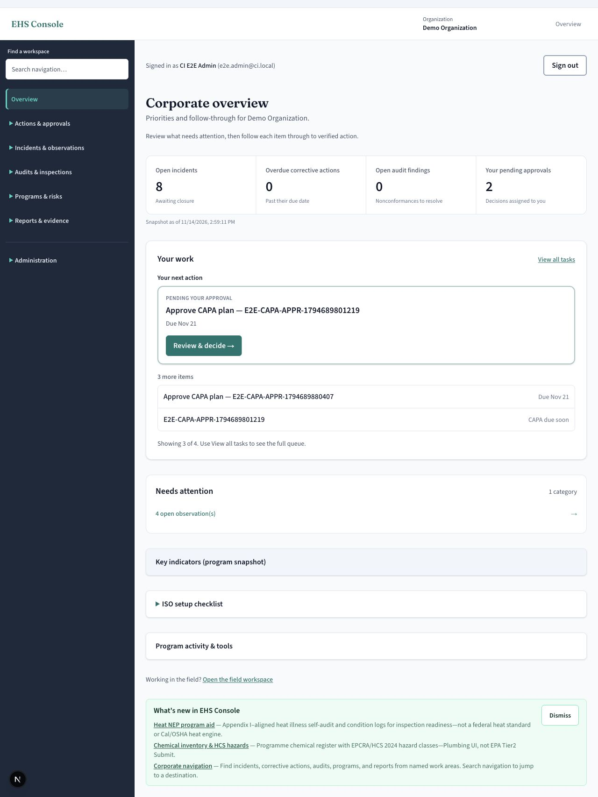

# Autonomous EHS Management: Self-Hosted Corporate EHS Software

[](https://github.com/SafetyMP/Autonomous-EHS-Management/actions/workflows/ci.yml)
[](https://github.com/SafetyMP/Autonomous-EHS-Management/actions/workflows/pages-demo.yml)
[](LICENSE)

A conveyor guard is back in place after a near miss at North plant. Maintenance can say what it installed. Operators on the next shifts observe how it behaves during work. Maya owns the corrective action, and Alex must decide whether the available observations support verification or another field check. [Open the shift handoff](https://safetymp.github.io/Autonomous-EHS-Management/)

Autonomous EHS connects an incident to a corrective action with a named owner in a self-hosted PostgreSQL application. When an authorized reviewer records a status change, the server saves the action, transition and audit event together. If the reviewer verifies the action, the record also stores who verified it and the notes explaining why. The next shift can read those notes on the verified action. In the browser, gather dock observations at River Distribution and hand them over, then apply the same reasoning to Maya’s conveyor file. [Follow the handover into the implementation](#trace-a-handover-into-the-implementation)

For a pilot, the EHS director can compare matched actions handled by email, a shared tracker and the console. Have the site coordinator time each review and count packets returned for missing evidence. Ask operators which observations survived the handoff. The plant manager can weigh that evidence against first-year setup and running costs. [Case and pilot assumptions](docs/github-pages-demo.md)

**[Open the technical guide](https://safetymp.github.io/Autonomous-EHS-Management/#/technical)** · **[Download a release](https://github.com/SafetyMP/Autonomous-EHS-Management/releases)** · **[Container package](https://github.com/SafetyMP/Autonomous-EHS-Management/pkgs/container/autonomous-ehs-management%2Fehs-web)** · **[Run locally](#run-the-demo)** · **[Documentation](docs/README.md)**

## Public walkthrough and full application

| | Public GitHub Pages demo | Full application package |
|---|---|---|
| Purpose | Gather cross-shift observations at the dock, review a conveyor-guard packet and compare pilot options | Run the EHS workflows in your own environment |
| Data | Synthetic, read-only examples | Your PostgreSQL database and organization records |
| Access | No sign-in; static HTML, CSS, and JavaScript | Better Auth sessions and server-enforced permissions |
| Actions | Compare shift packets and verification trials in the browser | Permission-gated mutations, human approvals, and workflow controls |
| Start | [Open the walkthrough](https://safetymp.github.io/Autonomous-EHS-Management/) | [Local setup](#run-the-demo) or [self-hosting guide](docs/self-host-quickstart.md) |

The walkthrough is published from [`demo/`](demo/) and has its own [verification and deployment workflow](.github/workflows/pages-demo.yml). It does not exercise backend authorization or prove deployment readiness. The previous Vercel public demo is deprecated; GitHub Pages is the public walkthrough. See [demo scope](docs/github-pages-demo.md).

The full application is distributed as source releases and a [GHCR container](https://github.com/SafetyMP/Autonomous-EHS-Management/pkgs/container/autonomous-ehs-management%2Fehs-web): `ghcr.io/safetymp/autonomous-ehs-management/ehs-web:<full-git-sha>`. Choose a published SHA or image digest and follow the [deployment requirements](docs/self-host-quickstart.md). GitHub release tags identify source releases; this is not an npm package.

### Trace a handover into the implementation

- **What goes to the next shift?** On the River Distribution dock, each notebook entry records a stop and shift. Issuing a handover preserves the observations available at that moment. The guide reopens the selected round so a reviewer can inspect what the team knew. [Dock round model](demo/field-round.js) · [Interactive trace](demo/technical-guide.js)
- **Who can verify the conveyor repair?** In the full application, the CAPA router checks the reviewer’s organization and update permission, the allowed change of status, and the verification notes. The reviewer judges whether the guard worked in the field. [CAPA mutation](src/server/trpc/routers/capa.ts) · [Transition rules](src/lib/workflow/capaTransitions.ts)
- **What does the next reviewer see?** A successful status change writes the action, workflow transition and audit event in one PostgreSQL transaction. The browser guide replays a hypothetical transition on synthetic records. [Stored record definitions](src/server/db/schema.ts) · [Transition tests](tests/unit/workflow/capaTransitions.test.ts) · [Trace an evening handoff](https://safetymp.github.io/Autonomous-EHS-Management/#/technical?handoff=advanced&trial=evening&phase=record)

## Incident and CAPA workflow



*Full application running locally with synthetic data, captured during corporate redesign verification.*

1. **Find the work:** use the overview and shared navigation for actions and approvals, incidents and observations, audits and inspections, programs and risks, or reports and evidence.
2. **Understand the incident:** review its details and investigation, then follow the linked corrective actions.
3. **Assign and track action:** keep ownership, due dates, approval steps, and status visible in the incident-to-CAPA journey.
4. **Verify the outcome:** authorized people review evidence and complete the existing workflow transitions.

Navigation is a way into existing workflows; it does not replace server authorization. Start with the [EHS console user manual](docs/user-manual-ehs-console.md), [workflow depth](docs/workflow-depth.md), and [CAPA approval rules](docs/approval-workflow.md).

The repository includes additional domains and optional integrations with different levels of maturity. Read the [module maturity map](docs/module-maturity.md) before evaluating a use case. This software does not certify compliance or provide official agency filing. Operators remain responsible for their deployment, records, and applicable obligations; see [COMPLIANCE.md](COMPLIANCE.md).

## Run the demo

This starts the **full application locally** with a seeded PostgreSQL database. To explore without installing anything, use the [static public walkthrough](https://safetymp.github.io/Autonomous-EHS-Management/).

Prerequisites: **Node.js 22**, **npm 10.9.2**, and **Docker with Compose**. The exact toolchain is recorded in [package.json](package.json) and [.nvmrc](.nvmrc).

```bash
git clone https://github.com/SafetyMP/Autonomous-EHS-Management.git
cd Autonomous-EHS-Management
npm ci
cp .env.demo.example .env.local
```

Before starting, edit `.env.local`: set a unique `BETTER_AUTH_SECRET` of at least 32 characters and change `DEMO_ADMIN_PASSWORD`. Keep the supplied local database URL on **127.0.0.1:5433** and `DATABASE_USE_PG=1`.

```bash
npm run demo:up
npm run dev
```

`demo:up` starts PostgreSQL, applies migrations, and seeds the example organization. Open [http://localhost:3000/sign-in](http://localhost:3000/sign-in) and choose **Try demo admin**, or use the demo credentials you set. [The health endpoint](http://localhost:3000/api/health) should return HTTP 200 with `{"ok":true,"database":"up"}`.

Stop the app with Ctrl+C, then stop the database while keeping its data:

```bash
docker compose -f docker-compose.demo.yml stop
```

If another PostgreSQL instance is on port 5432, an error such as `role "ehs" does not exist` may mean the URL points to that instance. Use the demo port **5433**. Do not enable `DEMO_MODE` in production. For production configuration, migrations, backups, and optional services, use the [self-hosting guide](docs/self-host-quickstart.md).

## TRIR

Total recordable incident rate uses `(recordable count × 200,000) / hours worked`.

- A complete grid of 12 months, each with hours, supplies the denominator.
- A partial grid warns and uses the saved annual `total_hours_worked` when available.
- With neither a complete grid nor an annual total, the rate is not computed.

See the [user manual](docs/user-manual-ehs-console.md) for incidence-rate reporting and its limits.

## Before a change

Read [CONTRIBUTING.md](CONTRIBUTING.md) and [AGENTS.md](AGENTS.md). `npm run verify` runs lint, type checks, and unit tests; `./scripts/verify.sh` also installs dependencies and runs audit-matrix and threat-model checks. CI adds browser and security checks. Static demo changes use their [separate Playwright configuration](playwright.demo.config.ts).

## More

- **Get help:** [SUPPORT.md](SUPPORT.md)
- **Report a vulnerability privately:** [SECURITY.md](SECURITY.md)
- **Direction and scope:** [ROADMAP.md](ROADMAP.md) and [module maturity](docs/module-maturity.md)
- **Maintainers, releases, and forks:** [GOVERNANCE.md](GOVERNANCE.md)
- **License and community:** [Apache 2.0](LICENSE) and [Code of Conduct](CODE_OF_CONDUCT.md)

Part of the [SafetyMP portfolio](https://github.com/SafetyMP/SafetyMP): reliable automation needs trustworthy records, assigned ownership, and verified corrective action.

## Documentation map

| Reader | Start here |
|---|---|
| Corporate EHS user | [Console user manual](docs/user-manual-ehs-console.md) |
| Evaluator | [Public demo scope](docs/github-pages-demo.md), [module maturity](docs/module-maturity.md) |
| Operator | [Self-hosting quick start](docs/self-host-quickstart.md), [runbooks](docs/runbooks/README.md) |
| Contributor or coding agent | [AGENTS.md](AGENTS.md), [CONTEXT.md](CONTEXT.md), [codebase layout](docs/codebase-layout.md) |
| Reviewer | [Architecture map](docs/architecture-map.md), [workflow depth](docs/workflow-depth.md), [compliance boundaries](COMPLIANCE.md) |

Use [docs/README.md](docs/README.md) for the complete documentation index. Current source and release notes take precedence over historical design and verification reports.
