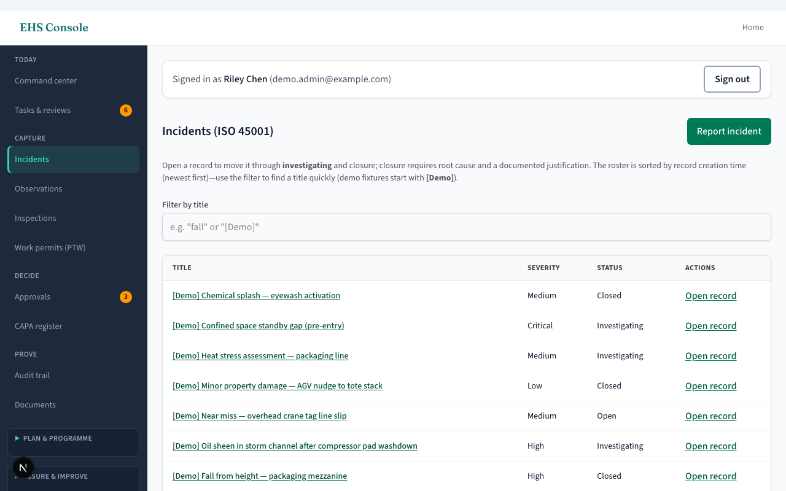
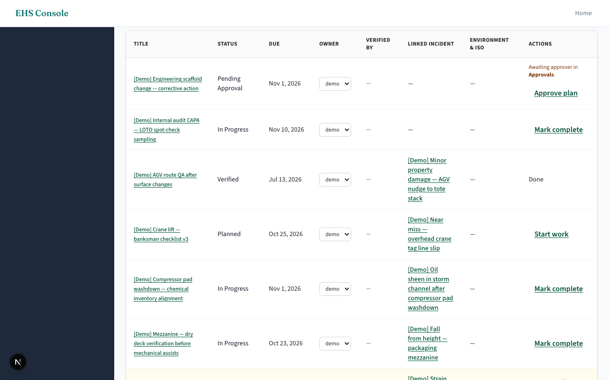
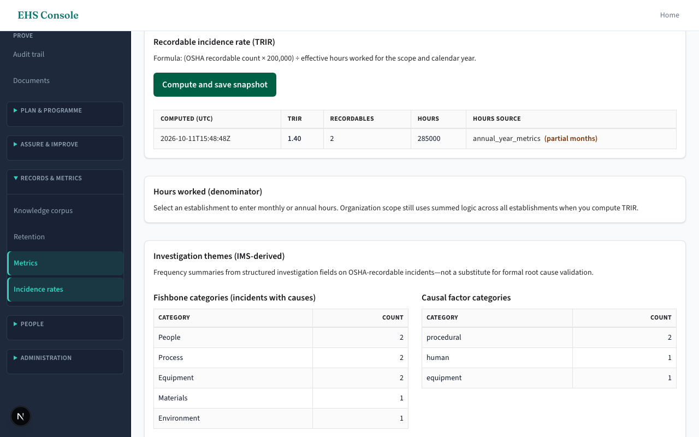

# Autonomous EHS Management: Self-Hosted EHS Software

[](https://github.com/SafetyMP/Autonomous-EHS-Management/actions/workflows/ci.yml)
[](LICENSE)

Autonomous EHS Management is a self-hosted **environmental, health and safety (EHS)** console for incident management, **corrective and preventive actions (CAPA)**, and **total recordable incident rate (TRIR)** reporting, with PostgreSQL as the system of record.

Record an incident, link a CAPA, and walk that CAPA to verified, on PostgreSQL you run. Optional AI may suggest wording. A person closes the record. This software does not claim OSHA certification and is not an official filing tool.

**SafetyMP operating thesis — reliability requires accountability.** Sustainable automation depends on trustworthy records, assigned ownership, and verification that corrective actions actually close. This project demonstrates those operational risk-management mechanisms in EHS: AI can assist with wording, but human review and closure remain essential. It is an EHS workflow reference, not an autonomous compliance authority. See the [portfolio thesis](https://github.com/SafetyMP/SafetyMP).

The main workflow is that spine. Other modules ship in the tree; maturity is listed in [docs/module-maturity.md](docs/module-maturity.md).

**Jump to:** [Public walkthrough](#public-walkthrough-and-full-application) · [Incident and CAPA workflow](#incident-and-capa-workflow) · [TRIR calculation](#trir) · [Run the demo](#run-the-demo) · [Self-hosting and security](#more) · [Documentation](#documentation-map)

## Public walkthrough and full application

| Experience | Use it for | Runtime |
|------------|------------|---------|
| [GitHub Pages walkthrough](https://SafetyMP.github.io/Autonomous-EHS-Management/) | Explore corporate navigation, the overview, and the incident-to-corrective-action journey with synthetic examples | Static files from `demo/`; no sign-in or database |
| [Full application](docs/self-host-quickstart.md) | Operate the EHS workflows with your organization's records and permissions | Next.js, authentication, and PostgreSQL; source and Docker/GHCR deployment |

The Pages URL is the public demo target; publication is tracked by the [Pages deployment workflow](https://github.com/SafetyMP/Autonomous-EHS-Management/actions/workflows/pages-demo.yml). The walkthrough does not exercise server permissions, persist operational records, or establish regulatory compliance. The previous Vercel public demo is deprecated. See [demo setup and scope](docs/github-pages-demo.md).

The full application remains a deployable package. CI publishes its container as `ghcr.io/safetymp/autonomous-ehs-management/ehs-web:<git-sha>` after the existing checks pass for image-relevant changes. Use a published immutable SHA for deployment; the public walkthrough is separate from that package.

## Incident and CAPA workflow

The core EHS workflow links incident records to corrective actions and human verification. Start with the [EHS console user manual](docs/user-manual-ehs-console.md) for field routes, or the [self-hosting quick start](docs/self-host-quickstart.md) for deployment instructions. The local demo below uses Docker and PostgreSQL.

**Record an incident**



**Link a CAPA**



**Read TRIR**



## TRIR

Incidence rates use `(recordable count × 200,000) / hours worked`.

- A complete grid of 12 months, each with hours, is the denominator.
- A partial month grid does not replace the annual total. The snapshot warns and uses `establishment_year_metrics.total_hours_worked` when that value exists.
- With neither a full grid nor an annual total, the rate is not computed.

## Run the demo

This local demo runs the **full application** with a seeded PostgreSQL database. For the static walkthrough without app setup, see [GitHub Pages demo](docs/github-pages-demo.md).

Prerequisites: Node.js 22 (`.nvmrc`), npm, Docker.

```bash
git clone https://github.com/SafetyMP/Autonomous-EHS-Management.git
cd Autonomous-EHS-Management
npm ci
cp .env.demo.example .env.local
npm run demo:up
npm run dev
```

Postgres from `docker-compose.demo.yml` is on host port **5433**. `DATABASE_URL` in `.env.demo.example` must use that port, with `DATABASE_USE_PG=1`. Set `BETTER_AUTH_SECRET` to at least 32 characters. Do not enable `DEMO_MODE` on a production deployment.

Open [http://localhost:3000/sign-in](http://localhost:3000/sign-in) and use **Try demo admin**, or the demo email and password from `.env.local`. Health check: [http://localhost:3000/api/health](http://localhost:3000/api/health).

Walk an incident into a verified CAPA from the console. The same path is covered by `tests/e2e/smoke/core-spine-capa-lifecycle.spec.ts`.

If port 5432 already has another Postgres, the error `role "ehs" does not exist` means the URL is pointed at that server. Use `127.0.0.1:5433`.

## Before a change

`./scripts/verify.sh` runs lint, typecheck, Vitest, and the threat-model check. CI also runs the smoke browser tests. See [CONTRIBUTING.md](CONTRIBUTING.md) and [AGENTS.md](AGENTS.md).

## More

- Field routes: [docs/user-manual-ehs-console.md](docs/user-manual-ehs-console.md)
- Public walkthrough: [docs/github-pages-demo.md](docs/github-pages-demo.md)
- Self-host: [docs/self-host-quickstart.md](docs/self-host-quickstart.md)
- Security reports: [SECURITY.md](SECURITY.md)
- License: [Apache 2.0](LICENSE)

Part of the [SafetyMP portfolio](https://github.com/SafetyMP/SafetyMP). For separate research into HAZOP hazard analysis for AI agent swarms, see [Agentic Process Safety (APS)](https://github.com/SafetyMP/Agentic-Process-Safety).


## Documentation map

[docs/README.md](docs/README.md) is the documentation index. Community policy files are the root `CONTRIBUTING.md`, `CODE_OF_CONDUCT.md`, and `SECURITY.md`.
